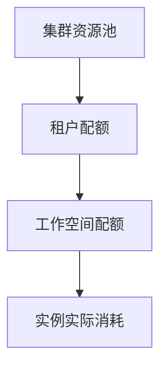

# 配额

配额回答的是「**这个租户、这个工作空间能用多少资源**」。平台把集群里的资源按「资源池 → 租户 → 工作空间」一层层分下来，你创建实例时消耗的就是当前工作空间分到的那一份。额度用完了，就算集群里还有空闲机器，实例也建不出来。

:::tip 一句话理解配额
配额像手机套餐的「流量」：总量由上级分给你，用到接近上限就该留意，用到上限就会创建失败。
:::

## 配额的层级

上层不给你，下层就用不了。所以实例创建失败时，先看工作空间配额，不要只看集群有没有空闲资源。

## 认识概念

| 名词 | 通俗解释 | 可以理解成 |
| --- | --- | --- |
| 保障配额 | 这一份额度里，平台保证你能用到的部分 | 套餐里的「保底流量」 |
| 配额上限 | 这一份额度最多能用到的天花板，通常大于或等于保障配额 | 套餐里的「封顶流量」 |
| 资源池 | 这份额度从哪个池子里划出来的 | 从哪个仓库批的货 |
| 用量状态 | 当前用量落在哪一档：保障内 / 超出保障 / 已达上限 / 已超上限 / 无可用配额 | 油表上的刻度 |

## 开始之前

- 查看配额需要角色是**管理员**或**开发者**；修改**工作空间配额**只能是**租户管理员**。
- 先点右上角头像进入租户，再进**租户集群**，见下面的入口步骤。

## 从哪进配额

配额不在控制台左侧的三组菜单里，路径是「头像 → 租户 → 租户集群 → 集群 → 配额页签」：

1. 点右上角头像，在菜单里点 **租户 你的租户名**。
2. 左侧点 **租户集群**，进入集群列表。
3. 点你要看的**集群名称**。
4. 页面顶部点 **配额** 页签。

## 租户配额怎么看

这个页签是**只读**的，显示这个租户在这个集群里分到的额度。

| 列 | 说明 |
| --- | --- |
| 类型 | 资源大类：CPU、内存、加速卡、共享GPU、存储、临时存储、磁盘等 |
| 资源池 | 这份额度来自哪个资源池 |
| 配额 | 每种资源的用量与额度，并画进度条 |

用量一列会同时显示 **保障配额** 和 **配额上限**，再加上当前已用量。状态口径：

| 用量状态 | 含义 |
| --- | --- |
| 保障内 | 用量还没超过保障配额，最宽松 |
| 超出保障 | 超过了保障配额，但还在配额上限内，仍可继续用 |
| 已达上限 | 正好用满，再创建会失败 |
| 已超上限 | 因为缩容等原因已经超过上限，需要尽快降下来 |
| 无可用配额 | 这项资源一点额度都没有分配 |

筛选条只有两个控件：**类型** 下拉和搜索框，没有「型号」筛选。

:::tip 进度条颜色
进度条表示占用比例：越接近上限颜色越警示，看到黄色就该盘算着清理或申请扩容了。
:::

## 看和调整工作空间配额

工作空间配额就是分给某个工作空间的那一份额度，也是租户管理员最常操作的一层。

1. 按上面的路径进到集群详情，点 **工作空间** 页签。
2. 点工作空间名称进入详情，点 **配额** 页签。
3. 如果是**租户管理员**，右上角有 **创建配额**，行上还有编辑和删除；其他角色只能看。

### 创建一个工作空间配额

1. 点击 **创建配额**。
2. 在 **配额配置** 里填写：

   | 表单项 | 怎么填 | 说明 |
   | --- | --- | --- |
   | 资源池 | 选择资源池 | 这份额度从哪个池子里划出来 |
   | 分类 → 资源 | 逐项添加 | 每个配额只配一项资源，CPU、内存、GPU 要分别创建；每加一项点 **创建资源** |
   | 型号与分配方式 | 选型号或「任意型号」 | GPU 还能配卡数、显存、核心 |
   | 保障配额 / 配额上限 | 填数量 | 保障配额 ≤ 配额上限，且不能超过上级（租户）还能分配的量 |

3. 点击 **确定**。

:::warning 配额不足会创建失败
页面上显示「集群还有资源」，并不代表当前工作空间一定能部署。真正生效的是逐级分配后的可用额度。额度不够时，请找租户管理员调整工作空间配额。
:::

删除配额前请确认没有实例还在依赖它，删除后无法通过撤销找回。

## 常见资源类型

| 类型 | 说明 |
| --- | --- |
| CPU | 计算核心数 |
| 内存 | 运行内存 |
| GPU | 独立显卡 |
| 共享GPU | 按显存或算力切分共享的显卡 |
| 存储 | 持久化容量 |
| 临时存储 | 实例的临时盘 |
| 磁盘 | 磁盘资源 |

## 小贴士

- 先按团队或项目拆工作空间，再分配配额，账目更清楚。
- GPU 按型号细分，避免高端卡被低优先级任务占满。
- 实例创建失败时优先查工作空间配额，而不是只看集群是否还有空闲。

## 相关

- [租户集群](/rune/console/tenant-clusters)
- [规格](/rune/console/flavor)
- [工作空间](/rune/console/workspace)
