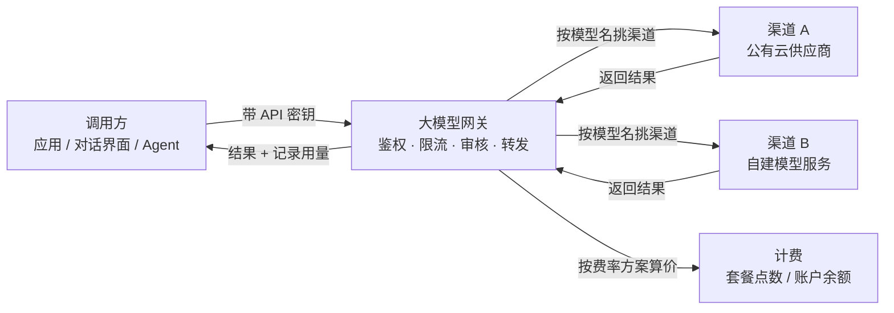
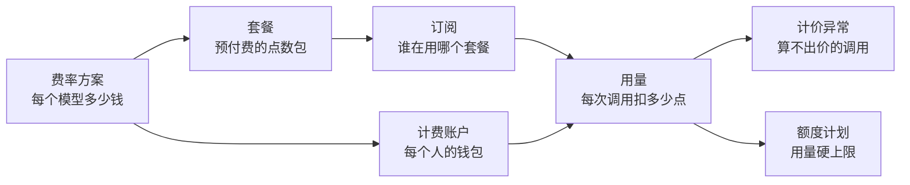

# 大模型网关

大模型网关（也叫 AI 网关）是平台上所有模型调用的**统一入口**。应用、对话界面、Agent 发出的模型请求都先到这里，由网关确认身份、检查限流、做内容审核，再转发给背后真正的模型供应商，最后把结果带回给调用方。

你作为平台管理员，在这里统一管理三件事：请求从哪出去、每次调用算多少钱、谁有密钥能调用。读完这一页，你会知道五个菜单分组各管什么，以及从哪一页开始配置。

:::tip 把网关理解成公司的总机
外部电话不会直接打到每个员工的座机，而是先拨总机。总机负责确认你是谁、有没有权限、该转给哪个部门，再把电话接过去。

大模型网关就是模型世界的「总机」：调用方只认一个地址，后面换了哪家供应商、哪条线路，调用方完全不用改。
:::

## 一次模型调用是怎么走的

1. 调用方带上 **API 密钥**（相当于门禁卡）发出请求，请求先到网关。
2. 网关先做三件事：验证密钥（你是谁）、检查限流（还能不能继续用）、做内容审核（内容合不合规）。
3. 网关根据请求里的**模型名**，挑一条可用的**渠道**。
4. 渠道把请求转发给它对接的模型供应商——可能是公有云（如 OpenAI、通义千问），也可能是平台自建的模型服务。
5. 供应商返回结果；网关顺带记下这次调用的用量（输入、输出各用了多少 Token，耗时多久）。
6. 计费环节再按**费率方案**里的价格把用量折成金额：先从调用方订阅套餐的**点数**里扣，点数不够或没有套餐时，看这个人有没有开启**超额扣费**，再决定是从**计费账户**余额里扣，还是拒绝这次调用。算不出价格的那一条会落到**计价异常**里等人补价。
7. 结果和扣费记录一起写进**调用日志**，数据看板再从这些记录里汇总趋势。

网关后面接的每个供应商，在平台上都被抽象成一条**渠道**。你后续要做的接入工作，基本都围绕渠道展开。

## 五个菜单分组

在 Boss 控制台顶部导航点 **大模型网关** 切过去之后，左侧栏的菜单分成五组，共 16 个页面。

| 分组 | 页面 | 这一页帮你解决什么 | 详细说明 |
| --- | --- | --- | --- |
| 大模型网关 | 数据看板 | 看请求量、成功率、Token 消耗和网关健康度 | [数据看板](/boss/gateway/operations) |
| 模型服务 | 渠道管理 | 对接模型供应商，决定请求从哪出去 | [渠道管理](/boss/gateway/channels) |
| 模型服务 | 模型配置 | 维护模型的名称、类型、厂家、上下文等元数据 | [模型配置](/boss/gateway/model-metadata) |
| 模型服务 | 费率方案 | 给模型定价，是全平台唯一的价格来源 | [费率方案](/boss/gateway/rate-plans) |
| 模型服务 | 计费账户 | 看每个人的余额、充值、调整、退款 | [计费账户](/boss/gateway/billing-accounts) |
| 模型服务 | 套餐计划 | 维护可售的计划与套餐档位 | [套餐计划](/boss/gateway/billing-plans) |
| 模型服务 | 订阅管理 | 给人开通套餐、取消订阅、开关自动续费 | [订阅管理](/boss/gateway/billing-subscriptions) |
| 模型服务 | 计价异常 | 处理算不出价格的调用，给它们补价 | [计价异常](/boss/gateway/usage-events) |
| 模型服务 | 额度计划 | 给用户或密钥设用量硬上限 | [额度计划](/boss/gateway/quota-plans) |
| 用户管理 | API 密钥 | 发放和管理调用用的密钥 | [API 密钥](/boss/gateway/api-keys) |
| 用户管理 | 调用日志 | 查每一次调用的明细与费用 | [调用日志](/boss/gateway/audit) |
| 安全服务 | 敏感词管理 | 维护审核用的词库 | [敏感词管理](/boss/gateway/moderation-lexicon) |
| 安全服务 | 策略管理 | 定义命中敏感词后怎么处理 | [策略管理](/boss/gateway/moderation-policies) |
| 安全服务 | 命中记录 | 查被审核拦下或改写的内容 | [命中记录](/boss/gateway/sensitive-hits) |
| 平台设置 | 网关配置 | 全局开关与运行参数 | [网关配置](/boss/gateway/config) |
| 平台设置 | 货币配置 | 金额用人民币还是美元显示 | [货币配置](/boss/gateway/currency-settings) |

:::info 菜单名和页面标题有时不一样
左侧菜单叫 **套餐计划**，打开后页面标题是「套餐」；菜单叫 **订阅管理**，页面标题是「订阅」。两处指的是同一页，看到标题不一样不用怀疑走错了。
:::

## 计费链路一图看懂

从定价到扣钱，中间有六个环节。按这个顺序理解，遇到「钱为什么没扣」「为什么提示未定价」，都能顺着链路找到对应的页面。

| 环节 | 页面 | 它负责什么 |
| --- | --- | --- |
| 定价 | [费率方案](/boss/gateway/rate-plans) | 声明每个模型（或某条渠道上的模型）的输入、输出、缓存、按次价格 |
| 钱包 | [计费账户](/boss/gateway/billing-accounts) | 每个人的默认账户：余额、冻结额、信用额度、账户费率 |
| 商品 | [套餐计划](/boss/gateway/billing-plans) | 把「多少点数、多少钱、多久」打包成可售的套餐 |
| 生效 | [订阅管理](/boss/gateway/billing-subscriptions) | 把套餐开给某个人，套餐的点数从此优先抵扣 |
| 记用量 | [调用日志](/boss/gateway/audit) | 每次调用的费用、选价层、套餐抵扣点数都在这里 |
| 兜底 | [计价异常](/boss/gateway/usage-events) | 没有命中任何价格、或计价失败的调用，在这里点对点补价 |
| 限量 | [额度计划](/boss/gateway/quota-plans) | 只限用量、不定价，和套餐点数同时生效 |

:::warning 未定价不等于 0 元
价格里填 `0` 表示**免费**；没有写价格叫**未定价**，这种调用会落到计价异常里等补价，不会被当成免费。渠道启用前也会检查它服务的模型是否已有平台默认价。
:::

## 开始之前

- 本菜单属于平台管理（Boss）控制台，只有平台管理员账号能看到。
- 上手顺序建议这样走：
  1. 在 **费率方案** 里确认平台默认方案，并给要用的模型**设置价格**；
  2. 在 **渠道管理** 里建渠道并**启用**（未定价的模型会被拦下）；
  3. 在 **模型配置** 里补全模型的展示信息（可选，不影响计价）；
  4. 在 **API 密钥** 里把密钥发给调用方；
  5. 用 **数据看板** 和 **调用日志** 核对效果，发现未定价就去 **计价异常** 补价。

## 核心概念

| 名词 | 通俗解释 |
| --- | --- |
| 渠道 | 网关背后对接的一家模型供应商，请求从这里出去 |
| 模型配置 | 模型的「名片」：叫什么、什么类型、上下文多长。不参与计价，也不决定走哪条渠道 |
| 费率方案 | 价目表。全平台只有一个默认方案，没单独标价的模型都按它算钱 |
| 计费账户 | 每个人的默认钱包，余额就在这里 |
| 套餐 | 提前买下的一包点数，1 点 = 0.01 元 |
| 订阅 | 某个人正在生效中的套餐，决定了这段时间里点数怎么扣 |
| 计价异常 | 这次调用没算出钱（缺价或失败），需要人工补价 |
| 额度计划 | 用量上限，只限量不定价 |
| API 密钥 | 发给调用方的门禁卡，请求时要带上 |
| 内容审核 | 门口的安检，检查进出的内容是否违规 |
| 调用日志 | 监控录像，记录谁在什么时候调用了什么、花了多少钱 |

## 关于钱，两件事要说清

- **网关负责算钱**：每次调用按费率方案算出一个金额，写进调用日志的费用列。这个金额可以从计费账户余额里扣（开启事后扣费后），也可以先从套餐点数里抵扣。
- **充值只在 BOSS 做**：BOSS 的计费账户页可以**充值、调整、退款**，可以给账户设信用额度；Console 侧的费用中心不提供充值，只能看余额、买套餐、看流水。

:::info 记账货币固定是人民币
所有金额都以人民币记账。美元只在展示时按 [货币配置](/boss/gateway/currency-settings) 的汇率折算出来，叫「参考价」，不参与扣费。
:::

## 相关

- [费率方案](/boss/gateway/rate-plans)：价格都在这里
- [渠道管理](/boss/gateway/channels)：请求从哪出去
- [网关配置](/boss/gateway/config)：全局开关与计费开关
- [调用日志](/boss/gateway/audit)：逐条核对每次调用
