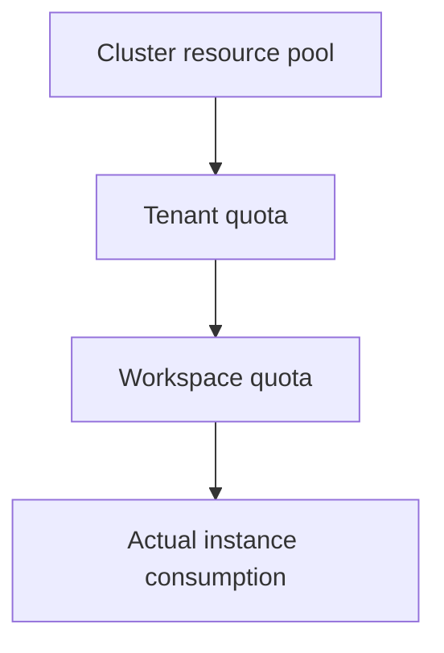

# Quota

Quota answers "**how much resource can this tenant and this workspace use**". The platform hands cluster resources down in layers — resource pool → tenant → workspace — and creating an instance consumes the share allocated to the current workspace. Once that share is used up, an instance cannot be created even if the cluster still has idle machines.

:::tip Quota in one line
Quota is like a mobile data plan: the total is handed down to you, you should pay attention as you approach the ceiling, and creating something fails when you reach it.
:::

## How quota is layered

If a higher layer does not give it to you, the lower layer cannot use it. So when instance creation fails, check the workspace quota first — do not just look at whether the cluster is idle.

## Core concepts

| Term | Plain explanation | Think of it as |
| --- | --- | --- |
| Guaranteed quota | The part of your share the platform guarantees you can use | The "guaranteed allowance" in a plan |
| Quota limit | The ceiling of your share, normally greater than or equal to the guaranteed quota | The "cap" in a plan |
| Resource pool | Which pool this share was carved out of | Which warehouse the goods came from |
| Usage state | Where current usage sits: within guarantee / above guarantee / at limit / over limit / no quota | The marks on a fuel gauge |

## Before you start

- Viewing quota requires the **Administrator** or **Developer** role; changing a **workspace quota** is restricted to a **tenant administrator**.
- Open the tenant from the avatar menu first, then go to **Tenant Clusters**, as shown below.

## Where to open quota

Quota is not in the console's three sidebar groups. The path is "avatar → tenant → Tenant Clusters → cluster → Quota tab":

1. Click the avatar in the top-right and click **Tenant <your tenant name>**.
2. Click **Tenant Clusters** on the left to open the cluster list.
3. Click the **cluster name** you want to inspect.
4. Click the **Quota** tab at the top of the page.

## Reading the tenant quota

This tab is **read-only** and shows what this tenant has been given in this cluster.

| Column | Description |
| --- | --- |
| Type | Resource family: CPU, memory, accelerator, shared GPU, storage, ephemeral storage, disk, and so on |
| Resource pool | Which pool this share comes from |
| Quota | Usage and capacity for each resource, drawn as a progress bar |

The quota cell shows both the **guaranteed quota** and the **quota limit**, together with current usage. Usage states:

| Usage state | Meaning |
| --- | --- |
| Within guarantee | Usage is still below the guaranteed quota — the most comfortable state |
| Above guarantee | Above the guaranteed quota but still within the limit; you can keep going |
| At limit | Exactly full; the next create will fail |
| Over limit | Above the limit (for example after scaling down); bring it down soon |
| No quota | No quota at all has been allocated for this resource |

The filter bar has only two controls: a **Type** dropdown and a search box. There is no "model" filter.

:::tip Progress bar colours
The bar shows the occupied ratio: the closer to the limit, the more alarming the colour. Yellow is your cue to clean up or request more quota.
:::

## Reading and adjusting workspace quota

A workspace quota is the share allocated to one workspace, and it is the layer a tenant administrator touches most.

1. Follow the path above to the cluster detail and click the **Workspace** tab.
2. Click a workspace name to open it, then click the **Quota** tab.
3. A **tenant administrator** sees **Create Quota** in the top right plus edit and delete on each row; other roles can only read.

### Create a workspace quota

1. Click **Create Quota**.
2. Fill in the **quota configuration**:

   | Field | What to do | Notes |
   | --- | --- | --- |
   | Resource pool | Choose a resource pool | Which pool this share is carved out of |
   | Category → Resource | Add items one by one | One resource per quota entry, so CPU, memory and GPU are separate entries; click **Create resource** for each |
   | Model and allocation | Pick a model or "any model" | GPUs also take card count, memory and cores |
   | Guaranteed quota / Quota limit | Enter numbers | Guaranteed ≤ limit, and must not exceed what the parent (tenant) can still allocate |

3. Click **Confirm**.

:::warning Insufficient quota makes creation fail
The page saying "the cluster still has resource" does not mean this workspace can deploy. What actually applies is the usable amount after layered allocation. If it is not enough, ask the tenant administrator to adjust the workspace quota.
:::

Before deleting a quota, confirm no instance still depends on it; a deleted quota cannot be restored by undo.

## Common resource types

| Type | Description |
| --- | --- |
| CPU | Compute cores |
| Memory | Runtime memory |
| GPU | Discrete graphics cards |
| Shared GPU | Cards split by memory or compute |
| Storage | Persistent capacity |
| Ephemeral storage | The instance's scratch disk |
| Disk | Disk resource |

## Tips

- Split workspaces by team or project first, then allocate quota — the books stay clearer.
- Break GPUs down by model so high-end cards are not filled by low-priority jobs.
- When instance creation fails, check the workspace quota rather than only whether the cluster is idle.

## Related

- [Tenant Clusters](/rune/console/tenant-clusters)
- [Flavor](/rune/console/flavor)
- [Workspace](/rune/console/workspace)
