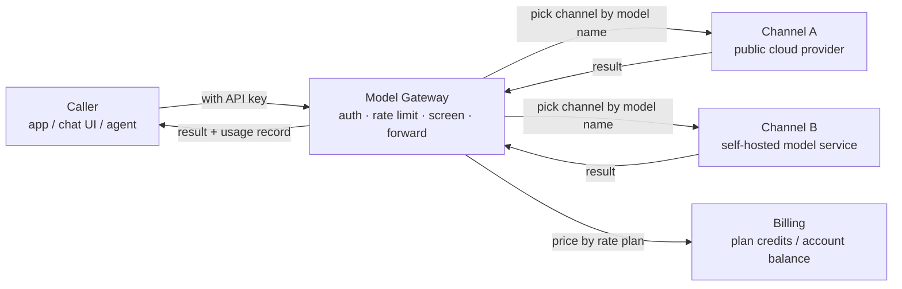
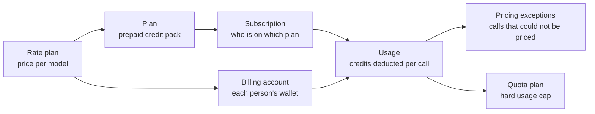

# Model Gateway

The Model Gateway (also called the AI Gateway) is the **single entry point** for every model call on the platform. Requests from applications, chat interfaces and agents all arrive here first. The gateway confirms identity, checks rate limits and screens the content, then forwards the request to the real model provider behind it and carries the result back to the caller.

As platform administrator, this is where you manage three things in one place: where requests go out, how much each call costs, and who holds a key that can call them. After reading this page you will know what each of the five menu groups does and which page to start configuring from.

:::tip Think of the gateway as a company switchboard
Outside calls never reach every employee's desk phone directly; they dial the switchboard first. The switchboard checks who you are and whether you are allowed through, decides which department to transfer you to, and then connects the call.

The Model Gateway is the switchboard of the model world: callers know only one address, so it does not matter to them which provider or route you use behind it.
:::

## How one model call travels

1. The caller sends a request carrying an **API key** (its door pass), and the request lands on the gateway first.
2. The gateway does three things: verifies the key (who you are), checks rate limits (whether you may keep going) and screens the content (whether it is allowed).
3. Based on the **model name** in the request, the gateway picks a usable **channel**.
4. The channel forwards the request to the model provider it is connected to — a public cloud provider such as OpenAI or Qwen, or a self-hosted model service on the platform.
5. The provider returns its result. The gateway records the usage along the way (how many input and output tokens, how long it took).
6. Billing then turns that usage into money using the prices in a **rate plan**: the call is first paid from the **credits** of the caller's active subscription. When the credits run out or there is no subscription, the **overage charge** switch on that subscription decides whether the remainder comes out of the **billing account** balance or the call is rejected. A call that cannot be priced at all lands in **Pricing exceptions** and waits for a manual reprice.
7. The result and the charge record are written to **Call Logs**, and the dashboard rolls those records up into trends.

Every provider behind the gateway is represented on the platform as a **channel**. Nearly all the setup work you do later revolves around channels.

## The five menu groups

After you click **Model Gateway** in the top navigation bar of the BOSS console, the sidebar menu is split into five groups with 16 pages in total.

| Group | Page | What this page solves for you | Details |
| --- | --- | --- | --- |
| Model Gateway | Dashboard | Request volume, success rate, token usage and gateway health | [Dashboard](/boss/gateway/operations) |
| Model Services | Channel Management | Connect model providers and decide where requests go out | [Channel Management](/boss/gateway/channels) |
| Model Services | Model Configuration | Maintain a model's name, type, vendor and context as metadata | [Model Configuration](/boss/gateway/model-metadata) |
| Model Services | Rate Plans | Price your models; the only price source on the platform | [Rate Plans](/boss/gateway/rate-plans) |
| Model Services | Billing Accounts | See each person's balance and add credit, adjust or refund | [Billing Accounts](/boss/gateway/billing-accounts) |
| Model Services | Plan Packages | Maintain the programs and plan tiers you sell | [Plan Packages](/boss/gateway/billing-plans) |
| Model Services | Subscription Management | Grant a plan to a person, cancel it, toggle auto-renew | [Subscription Management](/boss/gateway/billing-subscriptions) |
| Model Services | Pricing Exceptions | Handle calls that could not be priced, and reprice them | [Pricing Exceptions](/boss/gateway/usage-events) |
| Model Services | Quota Plans | Set hard usage caps for a user or an API key | [Quota Plans](/boss/gateway/quota-plans) |
| User Management | API Keys | Issue and manage the keys used to call the gateway | [API Keys](/boss/gateway/api-keys) |
| User Management | Call Logs | Inspect every call and what it cost | [Call Logs](/boss/gateway/audit) |
| Security Services | Sensitive Word Management | Maintain the word list used for screening | [Sensitive Word Management](/boss/gateway/moderation-lexicon) |
| Security Services | Policy Management | Define what happens when a word is matched | [Policy Management](/boss/gateway/moderation-policies) |
| Security Services | Hit Records | Review content that was blocked or rewritten | [Hit Records](/boss/gateway/sensitive-hits) |
| Platform Settings | Gateway Configuration | Global switches and runtime parameters | [Gateway Configuration](/boss/gateway/config) |
| Platform Settings | Currency Configuration | Whether amounts display in CNY or USD | [Currency Configuration](/boss/gateway/currency-settings) |

:::info Menu label and page title sometimes differ
The sidebar says **Plan Packages** but the page title reads "Plans"; the sidebar says **Subscription Management** but the page title reads "Subscriptions". Both refer to the same page, so a different title does not mean you opened the wrong one.
:::

## The billing chain in one picture

From setting a price to taking money, there are six steps. Read them in order: whenever "why was nothing charged" or "why does it say not priced" comes up, you can follow the chain to the right page.

| Step | Page | What it is responsible for |
| --- | --- | --- |
| Pricing | [Rate Plans](/boss/gateway/rate-plans) | Declares the input, output, cache and per-request prices of each model, or of a model on one channel |
| Wallet | [Billing Accounts](/boss/gateway/billing-accounts) | Each person's default account: balance, frozen amount, credit limit, account rate |
| Package | [Plan Packages](/boss/gateway/billing-plans) | Bundles "how many credits, what price, how long" into a sellable plan |
| Activation | [Subscription Management](/boss/gateway/billing-subscriptions) | Grants a plan to one person; its credits are then deducted first |
| Metering | [Call Logs](/boss/gateway/audit) | Cost per call, which price layer was used, and credits deducted by a plan |
| Fallback | [Pricing Exceptions](/boss/gateway/usage-events) | Calls that matched no price, or failed to price; reprice them one by one here |
| Caps | [Quota Plans](/boss/gateway/quota-plans) | Limits volume only, never sets a price; applies together with plan credits |

:::warning Not priced is not the same as free
A price of `0` means **free**. A model with no price at all is **not priced**, and such calls land in Pricing exceptions to be repriced — they are never treated as free. Enabling a channel also checks that the models it serves already have a platform default price.
:::

## Before you start

- This menu belongs to the platform administration (BOSS) console and is visible only to platform administrator accounts.
- A sensible order to get started:
  1. In **Rate Plans**, check the platform default plan and **set prices** for the models you will use;
  2. In **Channel Management**, create a channel and **enable** it (models without a price are rejected);
  3. In **Model Configuration**, fill in the model's display metadata (optional, does not affect pricing);
  4. In **API Keys**, hand a key to the caller;
  5. Use the **Dashboard** and **Call Logs** to check the result, and go to **Pricing Exceptions** to reprice anything that could not be priced.

## Core concepts

| Term | Plain explanation |
| --- | --- |
| Channel | One model provider the gateway is connected to; requests leave through it |
| Model configuration | A model's "business card": its name, type and context length. It neither prices the model nor decides the route |
| Rate plan | The price list. The platform has one default plan, and models without their own price are billed by it |
| Billing account | Each person's default wallet, where the balance lives |
| Plan | A pack of credits bought in advance; 1 credit = CNY 0.01 |
| Subscription | The plan currently active for one person, which decides how credits are deducted during that period |
| Pricing exception | A call that produced no cost (missing price or failure) and needs a manual reprice |
| Quota plan | A usage cap. It limits volume and never sets a price |
| API key | The door pass handed to a caller, carried with every request |
| Content moderation | The security check at the door, inspecting content going in and out |
| Call log | The security camera footage: who called what, when, and at what cost |

## Two things to be clear about money

- **The gateway does the pricing**: every call is priced by a rate plan, and the amount is written to the Cost column of Call Logs. That amount can be deducted from the billing account balance (once post-charge settlement is enabled), or paid first from plan credits.
- **Top-ups only happen in BOSS**: the Billing Accounts page in BOSS can **add credit, adjust and refund**, and can set a credit limit on an account. The Console billing center does not offer top-ups; it only shows the balance, sells plans and shows the ledger.

:::info The accounting currency is always CNY
All amounts are recorded in CNY. USD is only a display conversion using the exchange rate in [Currency Configuration](/boss/gateway/currency-settings); it is shown as a reference price and is never used for charging.
:::

## Related

- [Rate Plans](/boss/gateway/rate-plans): every price lives here
- [Channel Management](/boss/gateway/channels): where requests go out
- [Gateway Configuration](/boss/gateway/config): global switches, including billing
- [Call Logs](/boss/gateway/audit): check each call line by line
